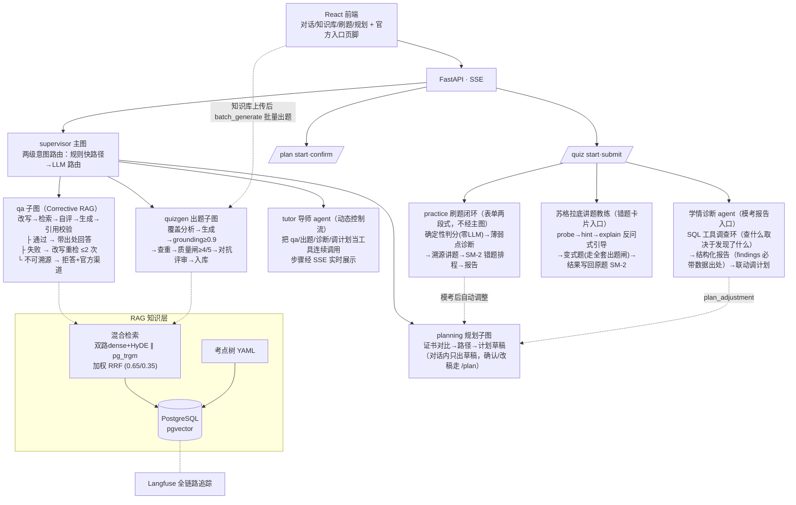

# 健身私教考证 Agent

[](https://github.com/xpzero/fitness-cert-agent-lc/actions/workflows/ci.yml)

LangGraph 多子图 + 溯源 RAG，面向健身教练国际四大认证备考（NSCA-CPT / ACE / ACSM / NASM 并列，规划页自选主考证书；引擎证书无关，cert_id 参数化）。

## 快速开始

```bash
cd backend && uv sync && cd ..    # 后端依赖（Python ≥3.11；首次需 uv）
cp backend/.env.example backend/.env  # 填入 LLM_API_KEY
make infra                        # PostgreSQL(pgvector) + Langfuse
make ingest                       # 考点树 + 种子语料入库
make web-build                    # 构建 React 前端（frontend/）
make serve                        # 前端 http://localhost:5173/ · API :8770
```

> 前端开发模式：`make web-dev`（:5173 热重载，API 走代理）；后端独立启动：`make api`。

## 架构



评测门槛：检索 Recall@5 ≥0.75 · 意图路由准确率 ≥0.92（当前 **0.939** ✅）· 出题逐字 grounding ≥0.9（拒绝线）· 质量闸 ≥4/5（拒绝线）· 对抗评审坏题捕获 ≥0.70 且误伤 ≤0.20（当前 **0.70 / ≤0.20** ✅，rubric 基线 0.10）· 引用正确率 ≥0.95（金标准 100 条已建，当前受检索基线拖累未达标——下一轮检索调优靶子）

## 结构

```
backend/          # Python 后端（uv 工程：pyproject + .venv）
  app/
    api/          # FastAPI：main.py 仅 app 工厂；routes/ 按域拆 5 个路由模块
                  #   （chat/quiz/kb/plan + supervisor 路由；quiz 含诊断 SSE 与教练三端点）；
                  #   schemas.py 请求模型、deps.py 图单例/SSE/追踪
    services/     # 业务下沉：kb_service(上传/删除/评测)、plan_stats(驾驶舱纯函数)、
                  #   quiz_stats(覆盖/徽章)、coach_service(讲题教练状态机)、
                  #   repositories(共享 SQL；单点查询就近内联于调用处)
    graphs/       # supervisor 主图（两级路由+tutor 适配）+ 六个子图
                  #   （planning/qa/quizgen/practice + diagnosis/tutor 两个 agent 工具环）；
                  #   common.py 线性图装配 + build_agent_loop（agent 循环骨架）
    rag/          # 摄取管线 pipeline（上传/种子同一路径）、混合检索 search、
                  #   引用校验 citation、分块 ingest、嵌入 embedder
    prompts/      # 全部 LLM 提示词按域集中（qa/quizgen/planning/practice/diagnosis/router）
    tools/        # 客观题确定性判分、SM-2、官方查询入口
    kb_worker.py  # KbIngestWorker：后台解析队列（类封装，phase→status 单表）
  knowledge/      # syllabus 考点树（YAML）；raw/（版权材料，gitignore）
  eval/           # 金标准集（检索/对抗注入/引用/意图路由四套）+ 指标脚本（门槛见设计文档 §7）
  scripts/        # ingest(种子语料)、batch_generate(批量出题)、ocr_pdf
  tests/          # 单元测试（判分/SM-2/RAG 纯函数）
frontend/         # React+shadcn 前端（lib/types.ts 共享类型 + constants.ts；dev/preview 代理 API）
Makefile          # 根编排（infra/api/serve/web-*/test/eval-*）
docker-compose.yml # PostgreSQL(pgvector) + Langfuse
```

## 功能与质量证据

- **溯源问答**（qa 子图）：Corrective RAG 全链路——改写 → 混合检索（双路 dense + HyDE + pg_trgm sparse + 加权 RRF）→ 自评 → 强制引用生成 → 引用校验；不可溯源直接拒答并给官方渠道。/chat SSE 实测通过（正答带出处；无关问题正确拒答）。
- **AI 出题**（quizgen 子图）：覆盖分析 → 生成（evidence 逐字摘抄）→ grounding ≥0.9 → 语义查重 → 质量闸 ≥4/5 → **对抗评审**（双 persona：较真考生找歧义 + 蒙题考生只看选项盲猜；投诉必须逐字引用原文，程序校验防编造指控）→ 入库；生成阶段线程池并行。对抗评审 vs rubric 打分基线：坏题捕获 0.70 vs 0.10（7 倍），好题误伤 ≤0.20。
- **刷题闭环**（practice，两段式表单不经主图）：确定性判分（漏选/多选判定，零 LLM）→ 薄弱点诊断 → 溯源讲题 → SM-2 错题排程 → 模考报告（通过概率参考 + 模考后自动调整规划）。
- **学情诊断 agent**（动态控制流）：SQL 工具调查环（各章正确率 → 下钻异常章错题类型 → 错题积压 → 模考趋势 → 对照计划，查什么取决于上一步发现了什么）；报告 findings 必带 {metric, value, source_tool} 数据出处；计划调整建议写回 active 计划；LLM 故障降级规则版。入口：刷题 tab 模考报告「AI 深度诊断」（SSE 调查时间线）。
- **苏格拉底讲题教练**：错题卡片内多轮对话（probe 反问定位误解 → hint 指向教材原句 → explain 才讲透）；讲透后出变式题（quizgen 定向出题走全套闸门），变式题结果**确定性判分并写回原题 SM-2 排程**——对话结果驱动复习排程。
- **会话级导师 agent**（tutor）：supervisor 两级路由（关键词快路径 + LLM 路由 ≥0.92 验收）后，导师把 qa/出题/诊断/调计划**当工具连续调用**（"我模考没过怎么办"→查学情→出题→调计划），工具步骤 SSE 实时展示。
- **备考规划**（planning 子图，真 HITL）：背景表单 → 证书对比/路径推荐 → 计划生成 → LangGraph interrupt 中断等确认 → 按意见重生成（循环）→ 确认落库 active。中断草稿由 **PostgresSaver 持久化**，跨重启可恢复。
- **检索评测**：Recall@5 金标准 + 对抗注入用例 + 引用金标准 100 条 + 意图路由 100 条，全部脚本化（`make eval-retrieval / eval-adversarial / eval-citation / eval-intent`），退出码供 CI。
- **知识库管理**：上传（md/txt/pdf 多文件 + 权威级绑定）→ 后台解析队列（扫描 PDF 自动 Vision OCR，按页进度）→ 索引 → 删除（引用保护：有题引用需 force，题目自动下架）；单文档召回评测（Recall@5/MRR@5 + miss 清单）；检索试驾三模式 + 分数构成。

**本机端口约定（8000/5432 被系统占用）：** 前端=5173（dev 与 preview，API 经 vite 代理到 8770），API=8770（独立进程，不托管前端），DB=5433，Langfuse=3000
**Langfuse：** 密钥在 .env；测试 trace `smoke-p0-001` 可在面板中查到

## 改进待办

- **题库扩容**：当前 verified 题量（15）远小于四大证模考规格（NSCA 155 等）——文档入库后自动铺题（覆盖驱动）在持续补库，题量上来后模考卷自然达到规格。
- **考点大纲校准**：`knowledge/syllabus/nsca_cpt.yaml` 仍为 draft 初稿（按公开考试领域手工整理、权重为估计值）；NASM 全套教材已入库，应按教材目录（TOC）校准考点树与权重——exam_points 是覆盖分析（pick_points）的地基。
- **本地检索金标准重建**（2026-10-11 评测课悬案，未拍板）：本地语料已 64,405 块/约 150 文档（权威1 占 73%），而 `rag_qa_auto.jsonl` 32 条仍全部指向种子笔记（权威3、48 块）——实测 Recall@5=0.312 vs CI 恒绿（CI 语料仅种子 1 文档）。miss 分类显示一半未命中并非检索之过（等价换出处/期望块跑题/auto 配对脱节）。候选方案：A 本地全语料重建金标准+双口径文档化（推荐）/ C 仅文档化 / D 分层金标准；B 检索域过滤已被否（复活简化手术删除的设计）。对比工具：`eval/scripts/_tmp_miss_compare.py`。
